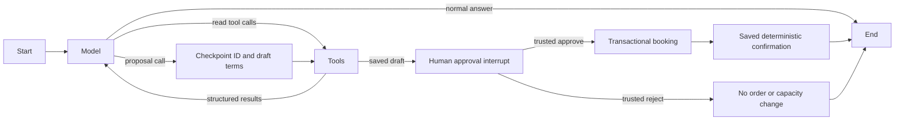

# LaundryAgent: persistent drafts and trusted human approval

## Run

The local `.env` supplies `NEBIUS_API_KEY`, `NEBIUS_BASE_URL` and your explicitly
selected `NEBIUS_MODEL`. A fresh checkout does not contain credentials or a model
selection; follow [README.md](README.md) first. This guide describes the CLI;
the current project also includes the [Streamlit interface](STREAMLIT_DEMO.md).

```bash
cd LaundryAgent
python3.12 -m venv .venv
source .venv/bin/activate
python -m pip install -r requirements.txt
python chat.py --session proposal-demo --business-db /tmp/laundry-demo-business.db --checkpoint-db /tmp/laundry-demo-state.db
```

Try these as separate turns:

1. What would it cost to wash and iron five garments?
2. Is evening pickup available?
3. What about morning?

For the new proposal flow, ask:

> Prepare a proposal to wash and iron five garments, morning pickup.

The model must collect service, quantity and slot; it may not guess missing
inputs. The application then displays the exact stored service code/name,
quantity, unit/total price, turnaround estimate and slot code/display window,
plus `request_id` and `snapshot_id`. This is a draft, not a reservation.

At `Decision (approve/reject, /quit):`, type **approve** or **reject**.
`yes`, `no`, model text and an earlier casual “yes” are not approval actions.
Invalid input leaves the same approval pending. `/quit` closes the chat
without approving or rejecting; rerun the printed resume command to decide
later. The commands above use synthetic databases in `/tmp`, not the original
business database. Without path flags, the project databases are used.

After `/quit`, resume the saved conversation with the same command:

```bash
python chat.py --session proposal-demo --business-db /tmp/laundry-demo-business.db --checkpoint-db /tmp/laundry-demo-state.db
```

Start a separate conversation with a different ID:

```bash
python chat.py --session another-demo --business-db /tmp/laundry-demo-business.db --checkpoint-db /tmp/laundry-demo-state.db
```

Without `--session`, the CLI generates an ID and prints the exact command
to resume it. `/new` starts an independent saved session and prints its
resume command; `/quit` exits. Checkpoints and pending approvals survive restart.
The model can save drafts but cannot approve or create a booking itself.
Slots have no dates, so current capacity is not a promise for a particular
day. Turnaround estimates are not promised calendar delivery dates.
Customer addresses are not supported or requested by this prototype.

Startup explicitly calls the existing `initialize_database()`. That may
create missing business tables or initial slot rows. After startup, the
four existing tools still only read the catalogue, calculate a quote, check a
slot, or list available slots. A fifth tool prepares a draft. Booking and
approval functions remain trusted application actions, not model tools.
`shop.py` now delegates its proposal/approval/booking wrappers to the existing
storage protections; the direct shop CLI retains its yes/no interaction.
The storage schema, immutable terms, approval transitions, idempotency and
transaction implementation are reused without changes.

## The graph



A **node** is a Python function doing one step. The model node calls Nebius;
the tool node validates and executes allowed reads. **Edges** say which
node runs next. A **conditional edge** inspects whether there are tool
calls or a stop reason to choose the next node or finish the turn.

`ChatState` contains messages, per-turn model/tool counters, and a stop
reason. `Annotated[..., add]` appends messages instead of replacing history.
Counters are ordinary fields, reset by `run_turn()` for each new user turn.
`turn_status` distinguishes a running turn, a completed answer, and a
stopped/failed turn. The key, SDK client and database connection are not in graph state.
Proposal plans, the pending proposal, its bound decision, and any actual
booking result are also checkpointed separately from the message list.

An **interrupt** is a real suspended graph step, implemented with
`langgraph.types.interrupt`. It is not a model instruction to wait. The
CLI resumes it with `Command(resume=...)` on the same thread ID.

Replay restarts a node from its beginning. `plan_proposal` therefore builds
a stable request ID and exact terms without a database write. Synchronous
checkpointing commits that plan before the tool node calls the existing
`storage.save_proposal`. Replaying that write reuses the ID and identical
terms; the existing insert-once/conflict checks prevent duplicate drafts.
One proposal is prepared per tool batch; read-only calls can still be batched.

The approval node performs no reads, writes or random-ID generation before
`interrupt()`. Trusted `resume_approval` checks the session's pending IDs and
stored immutable terms, then calls the existing approval-recording function.
The graph's resume payload alone cannot approve a proposal: the booking
write boundary still requires stored approval. Invalid raw resume payloads
route back to a fresh interrupt rather than creating an order.

After approval, a deterministic node calls the existing idempotent booking
function. Capacity, order, proposal state and mapping are still one business
transaction. Confirmation always uses the actual saved booking, including its
ID; there is deliberately **no post-commit model explanation call**. A model
outage therefore cannot hide a confirmed order or invent a failure.

`open_agent()` opens `SqliteSaver.from_conn_string(...)` in a `with` block
and yields the compiled graph. The graph is used inside that block; exiting
closes the checkpoint connection, including on errors. The supported saver
creates its own tables when needed. `build_agent()` receives this checkpointer
explicitly; it no longer constructs an in-memory saver. `run_turn()`
uses the same `configurable.thread_id` for every turn of one conversation.
The checkpointer restores its prior messages, including tool results, so
“What about morning?” can refer back to the evening pickup question.
Another thread ID has independent history. Restarting with the same
checkpoint file and thread ID restores that conversation.
Conversations from the earlier in-memory version were never saved and cannot
be recovered by this change.

**Graph state** is the current messages, counters and status. A **checkpoint**
is a saved snapshot of that state and the next graph step. The graph uses
`durability="sync"` so each step is saved before the next starts.
Only the new user message is submitted on a normal resumed turn; old messages
are not re-appended. System instructions are added once per model request
and are not saved as repeated conversation messages.

Both databases now persist, but serve different purposes: `laundry.db`
contains business orders/capacity; `agent_state.db` contains LangGraph
checkpoints and conversation messages. Reading a slot does not consume
capacity. A different session ID does not reset business data.

Override paths for isolated runs (the parent directories must exist):

```bash
python chat.py --session isolated-demo --checkpoint-db /tmp/chat-state.db --business-db /tmp/chat-business.db
```

The two paths must identify different files, including through symlinks or
hard links. Database files and SQLite WAL/SHM/journal sidecars are gitignored.
Imports do not open either database, load credentials or contact Nebius.

## Resume limits

Session IDs select stored history; they do **not** authenticate a user or
enforce ownership. This is a single-user, local synthetic-data prototype.
Do not use the same thread from multiple chat processes simultaneously.
Checkpoints contain local conversation text; do not put credentials in chat.

Old availability messages are historical snapshots. A question about current
availability must use a fresh tool lookup. Slot data still has no dates.

An expected approval interrupt is recognized and displayed for a trusted
decision. New free-form chat cannot skip it. The known draft-write and
approved-booking/confirmation steps can also recover on restart, using the
checkpointed ID and existing storage idempotency. If a process exits just
after booking commit, replay returns the same saved booking without another
approval or capacity reduction. A completed resume call is a no-op, not
another approval. Rejected proposals cannot be revived through resume.

Other pending steps, running turns or incomplete tool sequences remain
blocked; use `/new` or another session. A failed booking never prints a
confirmation; transaction rollback leaves stored approval unchanged as
designed. This demo does not automatically retry an ended failed booking
turn. If its outcome is uncertain, resuming checks whether the stored proposal
is already booked and recovers that saved confirmation without a new approval
or order. Completed answers are not routinely printed again
on startup; a recovered post-commit result is explicitly labelled recovered.

Checkpointing is not exactly-once network execution: it cannot prove what
a provider did if the process died between a response and its checkpoint.
General interruption recovery, authentication, shared multi-user access,
retention/cleanup and encrypted storage remain unimplemented. Session IDs
and stored approvals are not customer identity or production authorization.
The current application includes a local Streamlit UI. Payments, external
messages and general order-lookup agent tools remain outside its scope.

Technical read failures are not automatically retried. The graph stops that
turn, skips the rest of its tool batch and labels the failure; it does not call
the result "no availability." Validation errors instead go back to the model
for clarification. The customer may explicitly try a new bounded turn once the
problem is resolved. Earlier messages and business bookings persist. The CLI
exits on technical failure: restart with the same session and database paths.
Streamlit leaves normal chat available after an ended technical-read failure;
interrupted workflow steps instead require its explicit Recover saved outcome
button. Recovery is not a generic retry loop or a human-support handoff.

## Important boundaries

- `NebiusModel` reuses the working SDK and configuration loader. It sends
  OpenAI-compatible messages directly, without another model adapter.
- `dispatch_tool()` uses an explicit allowlist, exact argument keys and
  strict value/type validation. It never evaluates model-generated code.
  This chat bounds quote quantities to 1–1,000 without changing the
  existing business function. Duplicate JSON keys are rejected.
- Every tool call gets one structured `role: tool` reply with its original
  call ID. Multiple calls are executed sequentially, then all replies are
  returned to the model together. Invalid arguments are returned as errors
  so the model can ask for clarification. Full/empty availability is a
  successful business result, distinct from technical failure.
- Unexpected model/read failures stop the turn with a fixed failure
  message. A failed tool stops the remaining batch; skipped calls still
  receive error replies so history has no dangling call IDs.
- The activity log shows only tool names, validated safe arguments, and
  success/error outcomes. Raw errors, credentials and private reasoning
  are not displayed. Provider reasoning fields are not put into history.
- The prompt requires current tool results for prices/availability, asks
  for missing information, and states the booking/date limitations.
  Natural-language interpretation remains model behaviour, not a new
  business validation rule. Only draft creation is a model-accessible write;
  no approval, booking, superseding, arbitrary SQL or order-lookup tool exists.

The previous demo forced one quote call and one answer. This graph chooses
among four read tools and one draft tool, with a persistent human pause and history
across user turns. Neither version lets a model execute Python directly.

## Limits and verification

Each turn permits at most four model calls and eight tool attempts, with
at most four calls per model response. A separate LangGraph recursion limit
is a final guard. Nebius requests time out after 20 seconds, disable automatic
retries, and cap output at 384 tokens. The terminal process permits at most
100 model calls. Input/output and history are also bounded; `/new` starts
fresh conversational history but does not reset that CLI process API budget.
Streamlit constructs a lazy model client per action; that 100-call counter is
not a persistent browser-session quota. Per-turn graph limits still apply.

```bash
python -m unittest -v test_agent_approval test_approval_integrity test_laundry_agent test_laundry_persistence test_nebius_check
```

Offline tests explicitly use fake model responses, real business functions
and temporary databases. They test routing, multi-call sequencing, follow-ups,
session isolation, validation, technical errors, limits, safe logs, startup
and import behaviour. Persistence tests additionally cover real subprocess
exit/restart, message identity without duplication, fresh reads, connection
closure and unfinished checkpoints. They do not establish live model reliability.
New tests cover pending-approval restart, invalid/forged decisions, stale
terms, draft-write replay, capacity races, duplicate resumes, transaction
failure and a real subprocess exit after commit. Earlier milestone plans and
synthetic harness approvals are not a live quality benchmark. The session later
included an explicit user-approved terminal demo and a user-operated Streamlit
demo. No live requests were made for submission packaging. See the consolidated
[evaluation](docs/EVALUATION.md) for actual evidence and current suite totals.

The seed data and one-unit-per-booking capacity rule are described in the
[README](README.md#synthetic-data-and-business-rules). There are no dated slots
or guaranteed calendar-date deliveries, even after approval.

## Official references consulted

- [LangGraph quickstart: nodes, edges and the tool loop](https://docs.langchain.com/oss/python/langgraph/quickstart)
- [Graph API: state reducers and recursion limits](https://docs.langchain.com/oss/python/langgraph/graph-api)
- [Persistence and thread IDs](https://docs.langchain.com/oss/python/langgraph/persistence)
- [Checkpointers: saved steps, next tasks and synchronous durability](https://docs.langchain.com/oss/python/langgraph/checkpointers)
- [Interrupts and resume/replay rules](https://docs.langchain.com/oss/python/langgraph/interrupts)
- [Supported SQLite saver and connection lifecycle](https://reference.langchain.com/python/langgraph.checkpoint.sqlite/SqliteSaver)
- [Nebius function calling: schemas, auto tool choice and tool-message protocol](https://docs.tokenfactory.nebius.com/ai-models-inference/function-calling)
